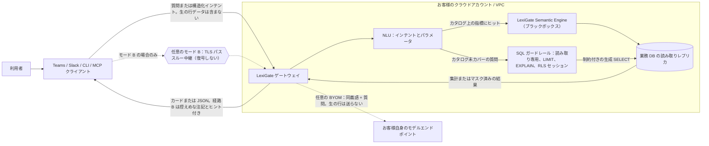

# LexiGate Core

**LexiGate** は、Microsoft Teams（およびその他のチャットフロント）と、AWS 上の業務データベース（RDS / Aurora、PostgreSQL および MySQL）をつなぐセマンティックゲートウェイです。日常の言葉で質問すると、本番スキーマに対する無制限の対話ではなく、ガバナンスされたセマンティック層から回答が返ります。

このリポジトリは **Open-Core の公開部分** で、[Apache License 2.0](LICENSE) です。公開する契約（`semantic_map` 仕様、アーキテクチャとセキュリティの文書、架空のデモデータ、そして近日公開予定のスキーマスキャナとローカル CLI デモ）を収めています。

企業向け機能——Microsoft Entra ID による行・列レベルの権限、監査ログのエクスポート、アウトバウンドトンネル、管理コンソール、複数データベースのルーティング、本番コネクタ——は **プライベート** リポジトリ `lexigate-ee` にあり、ここには含まれません。

> **現在の状態（2026 年 11 月）：** 今回の公開は、文書、v0 仕様、架空の月次決算デモデータ、およびローカル MCP サーバーのスケルトンです。スキャナ CLI、`docker compose` デモ、`lexigate ask`、実際に問い合わせできる MCP サーバーは **Phase 1 の予定であり、このリビジョンには実装されていません**。現時点でクローンしても、実行可能な製品にはなりません。

[English README](README.md) · [中文说明](README.zh.md)

## Open-Core モデル

| 公開（`lexigate-core`、Apache 2.0） | 非公開（`lexigate-ee`、商用クローズドソース） |
|---|---|
| `semantic_map.yaml` 仕様と JSON Schema | Excel『テーブル定義書』パーサ、クエリログ採掘、ローマ字補完 |
| スキーマスキャナ CLI（*Phase 1*） | Entra ID の行・列レベル権限マッピング |
| ローカル Docker Compose + `lexigate ask` デモ（*Phase 1*） | 高度な SQL ガードレール、S3 / SIEM への監査エクスポート |
| プラグインインタフェース（`AuthProvider`、`SchemaEnricher`、`SQLGuardrail`、`AuditLogger`、`TunnelAdapter`）（*Phase 1*） | アウトバウンドトンネルクライアント、CloudFormation HA、複数 DB ルータ |
| MCP ツール契約 + ローカルデモ DB 専用のサンプルサーバー（*Phase 1*） | 管理コンソール、稟議フロー、ROI レポート |
| 架空の月次決算サンプルデータ（本リビジョンに含む） | オフライン署名ライセンス（中継への定期通信は不要） |

コアはライブラリとして設計し、プラグイン登録は `entry_points` を使います。エンタープライズ版は公開された core の版に依存し、プラグインを注入します。core の中に `if is_enterprise` は置きません。

## アーキテクチャ

業務の生データは **お客様の VPC** の外に出ません。ゲートウェイが返すのは集計またはマスク済みの結果だけです。大規模言語モデルを使う場合は、**お客様自身のクラウドアカウント** で実行します（BYOM）。既定のネットワークは **モード A**：お客様がホストするエンドポイントで、LexiGate が運用する中継は使いません。モード B（アウトバウンドのみの TLS パススルー中継）は任意で、通信を復号しません。

**LexiGate Semantic Engine**（指標定義、日本語の業務同義語、ローマ字辞書、プロンプト論理）は、公開アーキテクチャ上はブラックボックスです。このリポジトリが公開するのは契約（`semantic_map`）であり、その内部実装ではありません。

六層の防御原則と二つの導入モードを含む詳細は、[docs/architecture.md](docs/architecture.md) と [docs/security.md](docs/security.md) を参照してください。

## 二経路の回答

LexiGate は、次の二通りで質問に答えます。

1. **セマンティック層の固定クエリ（優先）。** 「先月末時点の承認済み未払い出張精算は？」のような、よく使う価値の高い質問は `semantic_map.yaml` の指標に結び付け、固定のパラメータ付きクエリで実行します。速く、安定しています。
2. **モデル生成 SQL（フォールバック）。** カタログがカバーしていない質問だけ、モデルが単一の `SELECT` を生成します。実行前に、読み取り専用チェック、必須の `LIMIT`、`EXPLAIN` によるコスト判定、そのリクエストの RLS セッションコンテキストを必ず通します。参照できるのはセマンティックマップの `sql_guard` が許したリレーションだけです。

**回答の見せ方**

- 経路 2 の回答の末尾に、赤い小さな文字で控えめに注記します。例：「※ AI が作成した回答です。念のため内容をご確認ください」
- SQL 本文と口径の説明は **既定では出しません**。利用者が尋ねたときだけ表示します。
- どの回答にも、固定クエリで再質問できるような **問い方のヒントを 1～2 件** 付けます。
- 経路 2 の回答には、さらに「確認：さっきの SQL と根拠は？」を足します。選ぶと、その回答で使った SQL と口径を表示します。固定クエリの回答には、このヒントは付けません。

## 仕様とサンプル

- [`spec/semantic_map.md`](spec/semantic_map.md) — セマンティックマップ v0（インテント、指標、リレーション、権限、証跡、`sql_guard`）。
- [`spec/semantic_map.schema.json`](spec/semantic_map.schema.json) — 同じ文書の JSON Schema（YAML または JSON）。
- [`spec/mcp.md`](spec/mcp.md) — MCP ツール契約（`resolve_intent`、`query_metric`、`get_evidence` など）。
- [`examples/monthend/`](examples/monthend/) — 架空の日本の月次決算データセットと、サンプルの `semantic_map.yaml`。人物・会社はすべて架空です。
- [`examples/mcp-server/`](examples/mcp-server/) — ツールを宣言し、クエリ実行がまだ未実装であることを明示する MCP サーバーの **スケルトン**。

## ロードマップ

| フェーズ | 内容 | このリビジョンでの状態 |
|---|---|---|
| 0 | 組織プロフィール、アーキテクチャ文書、`semantic_map` v0、架空のデモデータ | **本リポジトリで公開済み** |
| 1 | `lexigate scan`（PostgreSQL のメタデータ → マップ草稿）、Docker Compose + `lexigate ask`、プラグインインタフェース、デモ DB 専用のローカル MCP サーバー | **これから。このリビジョンには未実装** |
| 2+ | 実需に応じて `lexigate-ee` に企業向けプラグインを追加（Entra、モード B トンネル、管理コンソール、MySQL スキャナなど） | 非公開。オープンソースとしての日程は置かない |

## ライセンス、商標、コントリビューション

- 本リポジトリのソースと文書：[Apache License 2.0](LICENSE)。
- 名称 **LexiGate** は商標です。[TRADEMARKS.md](TRADEMARKS.md) を参照してください。
- 貢献には DCO のサインオフ（`git commit -s`）が必要です。[CONTRIBUTING.md](CONTRIBUTING.md) を参照してください。現時点で CLA は求めません。
- 脆弱性は非公開で報告してください。[SECURITY.md](SECURITY.md)。

組織ページ：[github.com/lexigate](https://github.com/lexigate)
