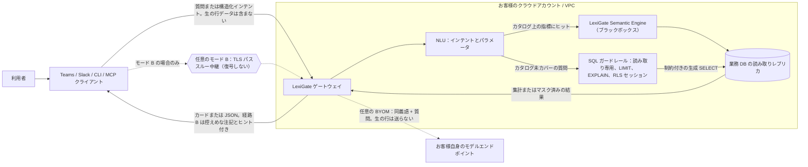

# LexiGate Core

**LexiGate** は、Microsoft Teams（およびその他のチャットフロント）と、AWS 上の業務データベース（RDS / Aurora、PostgreSQL および MySQL）をつなぐセマンティックゲートウェイです。日常の言葉で質問すると、本番スキーマに対する無制限の対話ではなく、ガバナンスされたセマンティック層から回答が返ります。

このリポジトリは **Open-Core の公開部分** で、[Apache License 2.0](LICENSE) です。公開する契約（`semantic_map` 仕様、アーキテクチャとセキュリティの文書、架空のデモデータ、PostgreSQL スキーマスキャナ `lexigate scan`、`lexigate ask` を含むローカル Docker Compose デモ）を収めています。

企業向け機能——Microsoft Entra ID による行・列レベルの権限、監査ログのエクスポート、アウトバウンドトンネル、管理コンソール、複数データベースのルーティング、本番コネクタ——は **プライベート** リポジトリ `lexigate-ee` にあり、ここには含まれません。

> **現在の状態（2026 年 11 月、バージョン 0.2）：** 文書、v0 仕様、架空の月次決算デモデータ、スキーマスキャナ `lexigate scan`、動かせるローカルデモ（`docker compose up` + `lexigate ask`、API キー不要）、デモ DB 専用の MCP サーバー（`lexigate mcp`）、そして任意のモデル生成 SQL（経路 2。自分の Gemini または OpenAI 互換キーを設定したときだけ有効）。**未実装**：安定 API としてのプラグインインタフェース。デモには認証も行レベル権限もなく、本番用ゲートウェイではありません。

[English README](README.md) · [中文说明](README.zh.md)

## クイックスタート

必要なもの：Docker と Compose v2。API キーは不要です（ルールベースの NLU と固定クエリのみ）。

```bash
git clone https://github.com/lexigate/lexigate-core && cd lexigate-core
docker compose up --build -d          # PostgreSQL 17 + 架空の月次決算データ + 問い合わせサービス（127.0.0.1:8080）
curl -s localhost:8080/v1/ask -H 'Content-Type: application/json' -d '{"question":"未払い出張精算はいくら？"}'
```

CLI でも聞けます（Python 3.10 以上）：

```console
$ python -m venv .venv && . .venv/bin/activate && pip install -e .
$ lexigate ask "未払い出張精算はいくら？"
（時点の指定がないため2026年2月末時点で回答）
2026年2月末時点で承認済み・未払いの出張精算は ¥371,240（17件・15名）です。
データ異常 C1011（超過支払）、C1012（明細なし） は合計から除外し、財務の確認対象です。

次の質問例： そのうち勤怠未確定は何名？ / C2016 の明細を見せて
$ lexigate ask "勤怠未確定は何名？"
（時点の指定がないため2026年2月末時点で回答）
2026年2月末時点の未払い出張精算のうち、勤怠未確定は 2名・2件（対象残高 ¥41,000）、確認事項 4件（人事 2件、本人 1件、部門承認者 1件）です。
```

デモが答える質問（[`examples/monthend/semantic_map.yaml`](examples/monthend/semantic_map.yaml) のインテントに結び付いた固定クエリ）：

| 質問の例 | インテント | 回答 |
|---|---|---|
| 未払い出張精算はいくら？ / 1月末時点の未払いは？ / 2月10日時点の未払い残高 | `unpaid_summary` | 承認済み・未払いの出張精算残高、件数・人数、データ異常 |
| 勤怠未確定は何名？ / 誰が確認すべき？ | `attendance_unconfirmed` | 未払い精算のうち勤怠が未確定の勤務日と確認担当 |
| 先月末時点の未払いはいくら？そのうち勤怠未確定は？ | 両方 | 残高と勤怠の内訳 |
| C1002 の明細を見せて | `claim_detail` | 精算書 1 件の明細・承認履歴・確定支払 |
| 営業部の未払い出張精算はいくら？ | `unpaid_summary` + 範囲 | 出張の帰属部門で絞り込み |

- デモの「今日」は 2026-03-10 に固定しています（`LEXIGATE_BASE_DATE`）。そのため「先月末時点」は 2026 年 2 月末です。時点のない質問はマップの `time.default_as_of` を使い、回答にその旨を書きます。
- それ以外の質問には、短い確認メッセージと質問例を返します（モデル生成 SQL を有効にした場合は経路 2 へ。次の節）。
- ローカルデモ専用です：架空データ、認証なし、行レベル権限なし（ID 連携と RLS は企業版プラグイン）。

### モデル生成 SQL（任意、経路 2）

常に固定クエリが先です。ルールで判定できない質問（例：「部門別の未払い残高は？」「未払い残高が一番大きい社員は誰？」）で、かつモデルを設定している場合だけ、LexiGate はモデルに SQL `SELECT` を 1 文だけ作らせます：

```bash
export GEMINI_API_KEY=...                 # または OPENAI_API_KEY=...（OpenAI 互換エンドポイントなら LEXIGATE_OPENAI_BASE_URL も）
docker compose up -d --build              # キーはシェルから渡すだけで、どこにも保存しません
```

```console
$ lexigate ask "部門別の未払い残高は？"
（時点の指定がないため2026年2月末時点で回答）
2026年2月末時点：部門別未払い出張精算残高
・開発部：未払い残高合計(円) ¥178,650、精算件数 8、対象人数 6
・営業部：未払い残高合計(円) ¥87,070、精算件数 6、対象人数 6
・人事部：未払い残高合計(円) ¥57,170、精算件数 1、対象人数 1
・経理部：未払い残高合計(円) ¥48,350、精算件数 2、対象人数 2

※ AI が作成した回答です。念のため内容をご確認ください

次の質問例： 先月末時点の未払い出張精算はいくら？ / 勤怠未確定は何名？ / 確認：さっきの SQL と根拠は？
$ lexigate ask "確認：さっきの SQL と根拠は？"
直前の回答（AI 作成）の SQL と根拠です。
【SQL】
SELECT attributed_department_ja, sum(balance_yen) AS total_unpaid_balance, … FROM sem.claim_balance_at('2026-03-01T00:00:00+09:00') WHERE balance_yen > 0 AND anomaly_code IS NULL GROUP BY … ORDER BY …
【口径】unpaid_trip_balance：締め時点前に最終承認済みの出張精算について、…（条件：balance_yen > 0 AND anomaly_code IS NULL）
…
```

- モデルが見るのは質問と、semantic_map のうちモデルに見せてよい部分（`sql_guard.allowed_relations` のリレーション、指標、用語、ルール）だけです。結果の行は見せず、回答文も書かせません。回答は LexiGate が結果から組み立てます。見出しと列名はモデルが付けるため、実行ごとに多少変わります。
- ガード（`lexigate.sqlguard`、sqlglot）：`SELECT` 1 文のみ。DML / DDL / `COPY` / `SELECT INTO` / ロック / `SET` は不可。許可リストのリレーションと関数のみ。パラメータは `:cutoff` のみ。外側に `LIMIT` を付けます。拒否した SQL は理由を添えて 1 回だけモデルに作り直させます。
- 実行：`READ ONLY` トランザクション、`SET LOCAL ROLE lexigate_query`（`sem.*` 関数の実行だけを許された NOLOGIN ロール。生の `demo` テーブルには権限なし）、`statement_timeout`、`EXPLAIN` のコスト上限、`search_path = pg_catalog`。
- 表示ルール：経路 2 の回答には `ai_generated: true` と `footer_ja` が付きます（赤い小さな文字で表示してください。`POST /v1/ask/card` と `/v1/ask/html` はそう描画します）。さらに質問例「確認：さっきの SQL と根拠は？」が 1 つ増え、同じ `session_id` で聞くと、その回答の SQL と使ったセマンティック定義を返します。固定クエリの回答には注記もこの質問例も付きません。聞かれない限り SQL は表示しません。
- 設定：`LEXIGATE_LLM_PROVIDER`（`auto` / `gemini` / `openai` / `none`）、`LEXIGATE_GEMINI_MODEL`、`LEXIGATE_OPENAI_MODEL`、`LEXIGATE_OPENAI_BASE_URL`、`LEXIGATE_SQL_MAX_ROWS`、`LEXIGATE_SQL_TIMEOUT_MS`。キーがなければ経路 2 は無効で、それ以外は同じように動きます。

### MCP サーバー

`lexigate mcp` は [MCP ツール契約](spec/mcp.md) を**ローカルのデモ DB 専用**で提供します。ローカル以外のホストや、`lexigate demo load` が書く目印のない DB には接続しません。SQL を受け取るツールはありません。ツール：`ask`、`list_questions`（= `list_metrics`）、`get_semantic_map`、`resolve_intent`、`query_metric`、`claim_evidence`、`get_evidence`（精算書の証跡、または求められたときに AI 回答の SQL と根拠）。

Claude Desktop（`claude_desktop_config.json`）など、stdio サーバーを起動できるクライアント：

```json
{
  "mcpServers": {
    "lexigate-demo": {
      "command": "/path/to/lexigate-core/.venv/bin/lexigate",
      "args": ["mcp"],
      "env": {
        "LEXIGATE_DSN": "postgresql://lexigate@127.0.0.1:55432/lexigate_demo",
        "PGPASSWORD": "lexigate-demo",
        "LEXIGATE_BASE_DATE": "2026-03-10",
        "LEXIGATE_SEMANTIC_MAP": "/path/to/lexigate-core/examples/monthend/semantic_map.yaml"
      }
    }
  }
}
```

（`pip install -e ".[mcp]"` でインストールし、ホストからデモ DB に届くよう `docker-compose.yml` の `db` のポート行のコメントを外します。`env` に `GEMINI_API_KEY` を足すと経路 2 が有効になります。）streamable HTTP 対応のクライアントは `docker compose --profile mcp up -d` の後 `http://127.0.0.1:8090/mcp` に接続するか、`lexigate mcp --transport http --port 8090` を自分で起動してください。

### 自社の PostgreSQL をスキャンする

```bash
pip install -e .
lexigate scan --dsn postgresql://readonly_user@db-host:5432/app --schema public -o semantic_map.draft.yaml
lexigate validate semantic_map.draft.yaml
```

`lexigate scan` はオフライン（モデル不使用）・読み取り専用セッションで動きます。テーブル、ビュー、列、型、主キー／一意キー／外部キー、`CHECK (… IN …)` の値リスト、列挙型、コメントを読み、カーディナリティの低いテキスト／真偽値列の値を一覧にします。氏名・連絡先・ID・自由記述らしい列は値を読みません。`--no-samples` ならメタデータのみです。出力は semantic_map v0 の**草稿**です：リレーションの粒度・キー・結合・日付項目・集計可能列、金額列とコメントから作った指標・用語の候補、空の `sql_guard.allowed_relations`。推定した項目にはすべて `review: needs_review` が付きます（[spec/semantic_map.md](spec/semantic_map.md#drafts-written-by-lexigate-scan) 参照）。デモ DB で試すには、`docker-compose.yml` の `db` サービスの `ports` 行のコメントを外し、`--schema demo` で `postgresql://lexigate@127.0.0.1:55432/lexigate_demo`（`PGPASSWORD=lexigate-demo`） をスキャンします。

### Docker を使わない場合

```bash
export LEXIGATE_DSN=postgresql://user@localhost:5432/lexigate_demo   # 自分の PostgreSQL 14 以上の DB。スキーマ demo と sem は作り直されます
export LEXIGATE_BASE_DATE=2026-03-10
lexigate demo load                    # examples/monthend/data を投入（ハッシュと行数を検査）
lexigate serve                        # http://127.0.0.1:8080（POST /v1/ask、/v1/ask/card、/v1/ask/html；GET /healthz、/v1/intents）
lexigate ask "勤怠未確定は何名？"       # HTTP を通さない場合は lexigate ask --local "…"
```

テスト：`pip install -e ".[test]" && pytest`。DB テストは `LEXIGATE_TEST_DSN` を使い、ローカルに PostgreSQL があれば `initdb` で使い捨てのクラスタを起動します。

## Open-Core モデル

| 公開（`lexigate-core`、Apache 2.0） | 非公開（`lexigate-ee`、商用クローズドソース） |
|---|---|
| `semantic_map.yaml` 仕様と JSON Schema | Excel『テーブル定義書』パーサ、クエリログ採掘、ローマ字補完 |
| スキーマスキャナ CLI `lexigate scan`（*0.1*） | Entra ID の行・列レベル権限マッピング |
| ローカル Docker Compose + `lexigate ask` デモ（*0.1*） | 高度な SQL ガードレール、S3 / SIEM への監査エクスポート |
| プラグインインタフェース（`AuthProvider`、`SchemaEnricher`、`SQLGuardrail`、`AuditLogger`、`TunnelAdapter`）（*Phase 1*） | アウトバウンドトンネルクライアント、CloudFormation HA、複数 DB ルータ |
| MCP ツール契約 + ローカルデモ DB 専用のサンプルサーバー（`lexigate mcp`、*0.2*） | 管理コンソール、稟議フロー、ROI レポート |
| 架空の月次決算サンプルデータ（本リビジョンに含む） | オフライン署名ライセンス（中継への定期通信は不要） |

コアはライブラリとして設計し、プラグイン登録は `entry_points` を使います。エンタープライズ版は公開された core の版に依存し、プラグインを注入します。core の中に `if is_enterprise` は置きません。

## アーキテクチャ

業務の生データは **お客様の VPC** の外に出ません。ゲートウェイが返すのは集計またはマスク済みの結果だけです。大規模言語モデルを使う場合は、**お客様自身のクラウドアカウント** で実行します（BYOM）。既定のネットワークは **モード A**：お客様がホストするエンドポイントで、LexiGate が運用する中継は使いません。モード B（アウトバウンドのみの TLS パススルー中継）は任意で、通信を復号しません。

**LexiGate Semantic Engine**（指標定義、日本語の業務同義語、ローマ字辞書、プロンプト論理）は、公開アーキテクチャ上はブラックボックスです。このリポジトリが公開するのは契約（`semantic_map`）であり、その内部実装ではありません。



六層の防御原則と二つの導入モードを含む詳細は、[docs/architecture.md](docs/architecture.md) と [docs/security.md](docs/security.md) を参照してください。

## 二経路の回答

LexiGate は、次の二通りで質問に答えます。

1. **セマンティック層の固定クエリ（優先）。** 「先月末時点の承認済み未払い出張精算は？」のような、よく使う価値の高い質問は `semantic_map.yaml` の指標に結び付け、固定のパラメータ付きクエリで実行します。速く、安定しています。
2. **モデル生成 SQL（フォールバック）。** カタログがカバーしていない質問だけ、モデルが単一の `SELECT` を生成します。実行前に、読み取り専用チェック、必須の `LIMIT`、`EXPLAIN` によるコスト判定、そのリクエストの RLS セッションコンテキストを必ず通します。参照できるのはセマンティックマップの `sql_guard` が許したリレーションだけです。

**回答の見せ方**

- 経路 2 の回答の末尾に、赤い小さな文字で控えめに注記します。例：「※ AI が作成した回答です。念のため内容をご確認ください」
- SQL 本文と口径の説明は **既定では出しません**。利用者が尋ねたときだけ表示します。
- どの回答にも、固定クエリで再質問できるような **問い方のヒントを 1～2 件** 付けます。
- 経路 2 の回答には、さらに「確認：さっきの SQL と根拠は？」を足します。選ぶと、その回答で使った SQL と口径を表示します。固定クエリの回答には、このヒントは付けません。

## 仕様とサンプル

- [`spec/semantic_map.md`](spec/semantic_map.md) — セマンティックマップ v0（インテント、指標、リレーション、権限、証跡、`sql_guard`）。
- [`spec/semantic_map.schema.json`](spec/semantic_map.schema.json) — 同じ文書の JSON Schema（YAML または JSON）。
- [`spec/mcp.md`](spec/mcp.md) — MCP ツール契約（`resolve_intent`、`query_metric`、`get_evidence` など）。
- [`examples/monthend/`](examples/monthend/) — 架空の日本の月次決算データセットと、サンプルの `semantic_map.yaml`。人物・会社はすべて架空です。
- [`examples/mcp-server/`](examples/mcp-server/) — ツール一覧と `lexigate mcp` の薄いラッパー（サーバー本体は `src/lexigate/mcp_server.py`）。

## ロードマップ

| フェーズ | 内容 | このリビジョンでの状態 |
|---|---|---|
| 0 | 組織プロフィール、アーキテクチャ文書、`semantic_map` v0、架空のデモデータ | **本リポジトリで公開済み** |
| 1 | `lexigate scan`（PostgreSQL のメタデータ → マップ草稿）、Docker Compose + `lexigate ask`、プラグインインタフェース、デモ DB 専用のローカル MCP サーバー | **ほぼ完了。** 0.1：`lexigate scan`、Docker Compose + `lexigate ask`。0.2：`lexigate mcp`、任意の経路 2（ガード付きモデル生成 SQL）。プラグインインタフェースは安定 API としては未公開 |
| 2+ | 実需に応じて `lexigate-ee` に企業向けプラグインを追加（Entra、モード B トンネル、管理コンソール、MySQL スキャナなど） | 非公開。オープンソースとしての日程は置かない |

## ライセンス、商標、コントリビューション

- 本リポジトリのソースと文書：[Apache License 2.0](LICENSE)。
- 名称 **LexiGate** は商標です。[TRADEMARKS.md](TRADEMARKS.md) を参照してください。
- 貢献には DCO のサインオフ（`git commit -s`）が必要です。[CONTRIBUTING.md](CONTRIBUTING.md) を参照してください。現時点で CLA は求めません。
- 脆弱性は非公開で報告してください。[SECURITY.md](SECURITY.md)。

組織ページ：[github.com/lexigate](https://github.com/lexigate)
