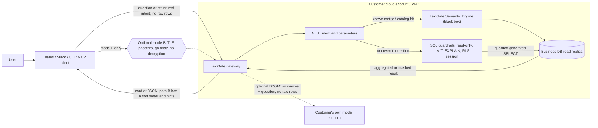

# LexiGate Core

**LexiGate** is a semantic gateway between Microsoft Teams (and other chat fronts) and business databases on AWS (RDS / Aurora, PostgreSQL and MySQL). People ask in everyday language; answers come from a governed semantic layer, not from an unbounded chat over the production schema.

This repository is the **open core**, licensed under [Apache License 2.0](LICENSE). It holds the public contracts: the `semantic_map` specification, architecture and security documentation, fictional demo data, and (soon) a schema scanner and a local command-line demo.

Enterprise capabilities — Microsoft Entra ID row- and column-level security, compliance audit export, the outbound tunnel, the admin console, multi-database routing, and production connectors — live in a **private** repository (`lexigate-ee`) and are not present here.

> **Current status (November 2026):** this publication is documentation, the v0 specification, fictional month-end demo data, and a skeleton for a local MCP server. The scanner CLI, `docker compose` demo, `lexigate ask`, and a working MCP server are **planned for Phase 1 and are not implemented in this revision**. Cloning this repository will not give you a running product yet.

[日本語 README](README.ja.md) · [中文说明](README.zh.md)

## Open-Core model

| Public (`lexigate-core`, Apache 2.0) | Private (`lexigate-ee`, commercial) |
|---|---|
| `semantic_map.yaml` specification and JSON Schema | Excel テーブル定義書 parser, query-log mining, romaji enrichment |
| Schema scanner CLI *(Phase 1)* | Entra ID RLS / CLS mapping |
| Local Docker Compose + `lexigate ask` demo *(Phase 1)* | Advanced SQL guardrails, audit export to S3 / SIEM |
| Plugin interfaces (`AuthProvider`, `SchemaEnricher`, `SQLGuardrail`, `AuditLogger`, `TunnelAdapter`) *(Phase 1)* | Outbound tunnel client, CloudFormation HA, multi-database router |
| MCP tool contract + a sample server that talks only to the local demo database *(Phase 1)* | Admin console, approval (稟議) flows, ROI report |
| Fictional month-end example dataset (this revision) | Offline signed license (no phone-home relay required) |

The core is designed as a library with a plugin registry (`entry_points`). Enterprise builds depend on a published core version and inject plug-ins. There is no `if is_enterprise` branch in core.

## Architecture

Raw business rows stay in the **customer VPC**. The gateway returns aggregated or masked results only. Large language models, when used, run in the **customer's own cloud account** (bring your own model). The default network mode is **Mode A**: a customer-hosted endpoint, with no LexiGate-operated relay. Mode B (an outbound-only TLS passthrough relay) is optional and does not decrypt traffic.

The **LexiGate Semantic Engine** (metric definitions, Japanese business synonyms, romaji dictionaries, and prompt logic) is a black box in the public architecture. This repository publishes the *contract* (`semantic_map`), not those internals.

See [docs/architecture.md](docs/architecture.md) and [docs/security.md](docs/security.md) for the full picture, including the six-layer guardrail principles and deployment modes.

## Dual-path answering

LexiGate answers a question in one of two ways:

1. **Fixed semantic query (preferred).** Common, high-value questions (for example “what is the unpaid approved trip-expense balance as of last month-end?”) are bound to a metric in `semantic_map.yaml` and executed as a fixed, parameterized query. These answers are fast and stable.
2. **Model-generated SQL (fallback).** If the catalog does not cover the question, a model may generate a single `SELECT`. That SQL must pass read-only validation, a mandatory `LIMIT`, `EXPLAIN` cost checks, and the request’s RLS session context before it is executed. It may only touch relations allowed by `sql_guard` in the semantic map.

**How the answer is presented**

- Path 2 answers show a short, soft note in small red type at the bottom, for example: 「※ AI が作成した回答です。念のため内容をご確認ください」 / “AI-generated — please double-check.”
- SQL text and business-rule commentary are **hidden by default**. They appear only if the user asks.
- Every answer includes one or two **suggested follow-up questions**, written so they can be served by a fixed semantic query.
- Path 2 answers add one extra suggestion: 「確認：さっきの SQL と根拠は？」 / “Show me the SQL and the rationale.” Choosing it reveals the SQL and the metric rules used for that answer. Path 1 answers do not include this suggestion.

## Specification and examples

- [`spec/semantic_map.md`](spec/semantic_map.md) — v0 of the semantic map (intents, metrics, relations, permissions, evidence, `sql_guard`).
- [`spec/semantic_map.schema.json`](spec/semantic_map.schema.json) — JSON Schema for the same document (YAML or JSON).
- [`spec/mcp.md`](spec/mcp.md) — MCP tool contract (`resolve_intent`, `query_metric`, `get_evidence`, …).
- [`examples/monthend/`](examples/monthend/) — a fictional Japanese month-end close dataset and an example `semantic_map.yaml`. All people and companies are fictitious.
- [`examples/mcp-server/`](examples/mcp-server/) — a **skeleton** MCP server that advertises the tools and clearly reports that query execution is not implemented yet.

## Roadmap

| Phase | What | Status in this revision |
|---|---|---|
| 0 | Organization profile, architecture docs, `semantic_map` v0, fictional demo data | **Published here** |
| 1 | `lexigate scan` (PostgreSQL metadata → draft map), Docker Compose + `lexigate ask`, plugin interfaces, a local MCP server bound to the demo database | **Coming — not in this revision** |
| 2+ | Enterprise plug-ins in `lexigate-ee` as real customer needs appear (Entra, Mode B tunnel, admin console, MySQL scanner, …) | Private, not scheduled as open source |

## License, trademark, and contributing

- Source and documentation in this repository: [Apache License 2.0](LICENSE).
- The name **LexiGate** is a trademark. See [TRADEMARKS.md](TRADEMARKS.md).
- Contributions need a Developer Certificate of Origin sign-off (`git commit -s`). See [CONTRIBUTING.md](CONTRIBUTING.md). We do not require a CLA.
- Please report vulnerabilities privately: [SECURITY.md](SECURITY.md).

Organization: [github.com/lexigate](https://github.com/lexigate)
