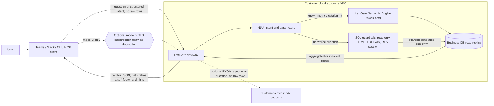

# LexiGate Core

**LexiGate** is a semantic gateway between Microsoft Teams (and other chat fronts) and business databases on AWS (RDS / Aurora, PostgreSQL and MySQL). People ask in everyday language; answers come from a governed semantic layer, not from an unbounded chat over the production schema.

This repository is the **open core**, licensed under [Apache License 2.0](LICENSE). It holds the public contracts: the `semantic_map` specification, architecture and security documentation, fictional demo data, a PostgreSQL schema scanner (`lexigate scan`), and a local Docker Compose demo with `lexigate ask`.

Enterprise capabilities — Microsoft Entra ID row- and column-level security, compliance audit export, the outbound tunnel, the admin console, multi-database routing, and production connectors — live in a **private** repository (`lexigate-ee`) and are not present here.

> **Current status (November 2026, version 0.1):** documentation, the v0 specification, fictional month-end demo data, the `lexigate scan` schema scanner, and a runnable local demo (`docker compose up` + `lexigate ask`, rules-based, no API key). Still **not implemented**: model-generated SQL (path 2), the plugin interfaces, and a working MCP server (the MCP server is a skeleton). The demo has no authentication and no row-level security; it is not a production gateway.

[日本語 README](README.ja.md) · [中文说明](README.zh.md)

## Quickstart (0.1)

Requirements: Docker with Compose v2. No API key is needed: the demo uses rules-based NLU and fixed queries only.

```bash
git clone https://github.com/lexigate/lexigate-core && cd lexigate-core
docker compose up --build -d          # PostgreSQL 17 + the fictional month-end data + the ask service on 127.0.0.1:8080
curl -s localhost:8080/v1/ask -H 'Content-Type: application/json' -d '{"question":"未払い出張精算はいくら？"}'
```

Or use the CLI (Python 3.10+):

```console
$ python -m venv .venv && . .venv/bin/activate && pip install -e .
$ lexigate ask "未払い出張精算はいくら？"
（時点の指定がないため2026年2月末時点で回答）
2026年2月末時点で承認済み・未払いの出張精算は ¥371,240（17件・15名）です。
データ異常 C1011（超過支払）、C1012（明細なし） は合計から除外し、財務の確認対象です。

次の質問例： そのうち勤怠未確定は何名？ / C2016 の明細を見せて
$ lexigate ask "勤怠未確定は何名？"
（時点の指定がないため2026年2月末時点で回答）
2026年2月末時点の未払い出張精算のうち、勤怠未確定は 2名・2件（対象残高 ¥41,000）、確認事項 4件（人事 2件、本人 1件、部門承認者 1件）です。
```

What the demo answers (fixed queries bound to the intents in [`examples/monthend/semantic_map.yaml`](examples/monthend/semantic_map.yaml)):

| Ask, for example | Intent | Answer |
|---|---|---|
| 未払い出張精算はいくら？ / 1月末時点の未払いは？ / 2月10日時点の未払い残高 | `unpaid_summary` | Approved, unpaid trip-expense balance, claim and people counts, data anomalies |
| 勤怠未確定は何名？ / 誰が確認すべき？ | `attendance_unconfirmed` | Unconfirmed attendance days on unpaid claims, with the role that must check each one |
| 先月末時点の未払いはいくら？そのうち勤怠未確定は？ | both | Balance plus the attendance breakdown |
| C1002 の明細を見せて | `claim_detail` | Lines, approval history and settled payments of one claim |
| 営業部の未払い出張精算はいくら？ | `unpaid_summary` + scope | Filtered by the department the trip is attributed to |

- The demo "today" is fixed at 2026-03-10 (`LEXIGATE_BASE_DATE`), so 先月末時点 means the end of February 2026. A question without a time uses `time.default_as_of` from the map and the answer says so.
- Anything else gets a short clarification with suggested questions. Model-generated SQL (path 2) is **not** in 0.1. The engine already has the extension point: an `AnswerPath` added to `Engine.paths` or published under the entry-point group `lexigate.answer_paths`; `Answer.mark_generated()` adds the soft footer and the “show me the SQL” suggestion.
- Local demo only: fictional data, no authentication, and no row-level security (identity and RLS are enterprise plug-ins).

### Scan your own PostgreSQL schema

```bash
pip install -e .
lexigate scan --dsn postgresql://readonly_user@db-host:5432/app --schema public -o semantic_map.draft.yaml
lexigate validate semantic_map.draft.yaml
```

`lexigate scan` runs offline (no model) in a read-only session. It reads tables, views, columns, types, primary / unique / foreign keys, `CHECK (… IN …)` value lists, enum labels and comments, and lists the distinct values of low-cardinality text / boolean columns. Columns that look like names, contact data, identifiers or free text are never sampled; `--no-samples` reads metadata only. It writes a semantic_map v0 **draft**: relations with grain, keys, joins, date fields and aggregatable columns; metric and term candidates from money columns and comments; an empty `sql_guard.allowed_relations`. Everything inferred is marked `review: needs_review` (see [spec/semantic_map.md](spec/semantic_map.md#drafts-written-by-lexigate-scan)). To try it on the demo database, uncomment the `ports` line of the `db` service in `docker-compose.yml` and scan `postgresql://lexigate@127.0.0.1:55432/lexigate_demo` (with `PGPASSWORD=lexigate-demo`) with `--schema demo`.

### Without Docker

```bash
export LEXIGATE_DSN=postgresql://user@localhost:5432/lexigate_demo   # a PostgreSQL 14+ database you own; schemas demo and sem are replaced
export LEXIGATE_BASE_DATE=2026-03-10
lexigate demo load                    # loads examples/monthend/data (hashes and row counts checked)
lexigate serve                        # http://127.0.0.1:8080  (POST /v1/ask, GET /healthz, GET /v1/intents)
lexigate ask "勤怠未確定は何名？"       # or: lexigate ask --local "…" to skip the HTTP service
```

Tests: `pip install -e ".[test]" && pytest`. Database tests use `LEXIGATE_TEST_DSN`, or start a throwaway cluster with `initdb` when PostgreSQL is installed locally.

## Open-Core model

| Public (`lexigate-core`, Apache 2.0) | Private (`lexigate-ee`, commercial) |
|---|---|
| `semantic_map.yaml` specification and JSON Schema | Excel テーブル定義書 parser, query-log mining, romaji enrichment |
| Schema scanner CLI `lexigate scan` *(0.1)* | Entra ID RLS / CLS mapping |
| Local Docker Compose + `lexigate ask` demo *(0.1)* | Advanced SQL guardrails, audit export to S3 / SIEM |
| Plugin interfaces (`AuthProvider`, `SchemaEnricher`, `SQLGuardrail`, `AuditLogger`, `TunnelAdapter`) *(Phase 1)* | Outbound tunnel client, CloudFormation HA, multi-database router |
| MCP tool contract + a sample server that talks only to the local demo database *(Phase 1)* | Admin console, approval (稟議) flows, ROI report |
| Fictional month-end example dataset (this revision) | Offline signed license (no phone-home relay required) |

The core is designed as a library with a plugin registry (`entry_points`). Enterprise builds depend on a published core version and inject plug-ins. There is no `if is_enterprise` branch in core.

## Architecture

Raw business rows stay in the **customer VPC**. The gateway returns aggregated or masked results only. Large language models, when used, run in the **customer's own cloud account** (bring your own model). The default network mode is **Mode A**: a customer-hosted endpoint, with no LexiGate-operated relay. Mode B (an outbound-only TLS passthrough relay) is optional and does not decrypt traffic.

The **LexiGate Semantic Engine** (metric definitions, Japanese business synonyms, romaji dictionaries, and prompt logic) is a black box in the public architecture. This repository publishes the *contract* (`semantic_map`), not those internals.



See [docs/architecture.md](docs/architecture.md) and [docs/security.md](docs/security.md) for the full picture, including the six-layer guardrail principles and deployment modes.

## Dual-path answering

LexiGate answers a question in one of two ways:

1. **Fixed semantic query (preferred).** Common, high-value questions (for example “what is the unpaid approved trip-expense balance as of last month-end?”) are bound to a metric in `semantic_map.yaml` and executed as a fixed, parameterized query. These answers are fast and stable.
2. **Model-generated SQL (fallback).** If the catalog does not cover the question, a model may generate a single `SELECT`. That SQL must pass read-only validation, a mandatory `LIMIT`, `EXPLAIN` cost checks, and the request’s RLS session context before it is executed. It may only touch relations allowed by `sql_guard` in the semantic map.

**How the answer is presented**

- Path 2 answers show a short, soft note in small red type at the bottom, for example: 「※ AI が作成した回答です。念のため内容をご確認ください」 / “AI-generated — please double-check.”
- SQL text and business-rule commentary are **hidden by default**. They appear only if the user asks.
- Every answer includes one or two **suggested follow-up questions**, written so they can be served by a fixed semantic query.
- Path 2 answers add one extra suggestion: 「確認：さっきの SQL と根拠は？」 / “Show me the SQL and the rationale.” Choosing it reveals the SQL and the metric rules used for that answer. Path 1 answers do not include this suggestion.

## Specification and examples

- [`spec/semantic_map.md`](spec/semantic_map.md) — v0 of the semantic map (intents, metrics, relations, permissions, evidence, `sql_guard`).
- [`spec/semantic_map.schema.json`](spec/semantic_map.schema.json) — JSON Schema for the same document (YAML or JSON).
- [`spec/mcp.md`](spec/mcp.md) — MCP tool contract (`resolve_intent`, `query_metric`, `get_evidence`, …).
- [`examples/monthend/`](examples/monthend/) — a fictional Japanese month-end close dataset and an example `semantic_map.yaml`. All people and companies are fictitious.
- [`examples/mcp-server/`](examples/mcp-server/) — a **skeleton** MCP server that advertises the tools and clearly reports that query execution is not implemented yet.

## Roadmap

| Phase | What | Status in this revision |
|---|---|---|
| 0 | Organization profile, architecture docs, `semantic_map` v0, fictional demo data | **Published here** |
| 1 | `lexigate scan` (PostgreSQL metadata → draft map), Docker Compose + `lexigate ask`, plugin interfaces, a local MCP server bound to the demo database | **In progress.** 0.1 ships `lexigate scan` and Docker Compose + `lexigate ask` (rules, fixed queries). Plugin interfaces, path 2 and the MCP server are not done yet |
| 2+ | Enterprise plug-ins in `lexigate-ee` as real customer needs appear (Entra, Mode B tunnel, admin console, MySQL scanner, …) | Private, not scheduled as open source |

## License, trademark, and contributing

- Source and documentation in this repository: [Apache License 2.0](LICENSE).
- The name **LexiGate** is a trademark. See [TRADEMARKS.md](TRADEMARKS.md).
- Contributions need a Developer Certificate of Origin sign-off (`git commit -s`). See [CONTRIBUTING.md](CONTRIBUTING.md). We do not require a CLA.
- Please report vulnerabilities privately: [SECURITY.md](SECURITY.md).

Organization: [github.com/lexigate](https://github.com/lexigate)
