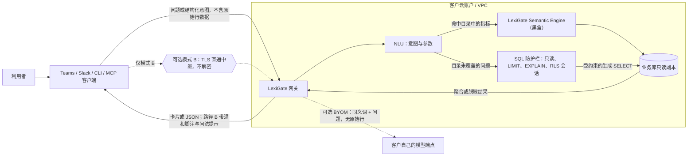

# LexiGate Core

**LexiGate** 是连接 Microsoft Teams（及其他聊天前端）与 AWS 业务数据库（RDS / Aurora，PostgreSQL 与 MySQL）的语义网关。人们用日常语言提问，回答来自受治理的语义层，而不是对生产库结构的无约束闲聊。

本仓库是 **Open-Core 的公开部分**，采用 [Apache License 2.0](LICENSE)。内容是公开契约：`semantic_map` 规范、架构与安全文档、虚构演示数据，PostgreSQL 结构扫描工具（`lexigate scan`），以及带 `lexigate ask` 的本地 Docker Compose 演示。

企业能力——Microsoft Entra ID 行/列级权限、合规审计导出、出站隧道、管理后台、多库路由和生产级连接器——放在**私有**仓库 `lexigate-ee`，不会出现在这里。

> **当前状态（2026 年 11 月，版本 0.2）：** 文档、v0 规范、虚构的月结演示数据、`lexigate scan` 结构扫描工具、可运行的本地演示（`docker compose up` + `lexigate ask`，不需要 API key）、只连演示库的 MCP 服务器（`lexigate mcp`），以及可选的模型生成 SQL（路径 2，只有配置了你自己的 Gemini 或 OpenAI 兼容 key 才启用）。**尚未实现**：作为稳定 API 发布的插件接口。演示没有认证，也没有行级权限，不是生产网关。

[English README](README.md) · [日本語 README](README.ja.md)

## 快速上手

需要：Docker 与 Compose v2。不需要任何 API key：演示只用规则式 NLU 和固定查询。

```bash
git clone https://github.com/lexigate/lexigate-core && cd lexigate-core
docker compose up --build -d          # PostgreSQL 17 + 虚构月结数据 + 问答服务（127.0.0.1:8080）
curl -s localhost:8080/v1/ask -H 'Content-Type: application/json' -d '{"question":"未払い出張精算はいくら？"}'
```

也可以用命令行（Python 3.10+）：

```console
$ python -m venv .venv && . .venv/bin/activate && pip install -e .
$ lexigate ask "未払い出張精算はいくら？"
（時点の指定がないため2026年2月末時点で回答）
2026年2月末時点で承認済み・未払いの出張精算は ¥371,240（17件・15名）です。
データ異常 C1011（超過支払）、C1012（明細なし） は合計から除外し、財務の確認対象です。

次の質問例： そのうち勤怠未確定は何名？ / C2016 の明細を見せて
$ lexigate ask "勤怠未確定は何名？"
（時点の指定がないため2026年2月末時点で回答）
2026年2月末時点の未払い出張精算のうち、勤怠未確定は 2名・2件（対象残高 ¥41,000）、確認事項 4件（人事 2件、本人 1件、部門承認者 1件）です。
```

演示能回答的问题（固定查询，绑定 [`examples/monthend/semantic_map.yaml`](examples/monthend/semantic_map.yaml) 中的意图）：

| 问法示例 | 意图 | 回答内容 |
|---|---|---|
| 未払い出張精算はいくら？ / 1月末時点の未払いは？ / 2月10日時点の未払い残高 | `unpaid_summary` | 已审批未付款的出差报销余额、件数与人数、数据异常 |
| 勤怠未確定は何名？ / 誰が確認すべき？ | `attendance_unconfirmed` | 未付款报销中考勤未确定的日期，以及每条该由谁确认 |
| 先月末時点の未払いはいくら？そのうち勤怠未確定は？ | 两者 | 余额 + 考勤明细 |
| C1002 の明細を見せて | `claim_detail` | 单张报销单的明细、审批记录、已结算付款 |
| 営業部の未払い出張精算はいくら？ | `unpaid_summary` + 范围 | 按出差归属部门筛选 |

- 演示的「今天」固定为 2026-03-10（`LEXIGATE_BASE_DATE`），所以「先月末時点」指 2026 年 2 月末。问题没写时点时，使用语义图里的 `time.default_as_of`，并在回答里写明。
- 其他问题会得到简短的澄清和问法提示；启用模型生成 SQL 后则交给路径 2（见下一节）。
- 仅限本地演示：虚构数据、无认证、无行级权限（身份与 RLS 属于企业版插件）。

### 模型生成 SQL（可选，路径 2）

始终先走固定查询。只有规则匹配不上（例如「部門別の未払い残高は？」「未払い残高が一番大きい社員は誰？」），并且你配置了模型时，LexiGate 才请模型生成一条 SQL `SELECT`：

```bash
export GEMINI_API_KEY=...                 # 或 OPENAI_API_KEY=...（任何 OpenAI 兼容端点再加 LEXIGATE_OPENAI_BASE_URL）
docker compose up -d --build              # key 从你的 shell 传入，不会写进任何文件
```

```console
$ lexigate ask "部門別の未払い残高は？"
（時点の指定がないため2026年2月末時点で回答）
2026年2月末時点：部門別未払い出張精算残高
・開発部：未払い残高合計(円) ¥178,650、精算件数 8、対象人数 6
・営業部：未払い残高合計(円) ¥87,070、精算件数 6、対象人数 6
・人事部：未払い残高合計(円) ¥57,170、精算件数 1、対象人数 1
・経理部：未払い残高合計(円) ¥48,350、精算件数 2、対象人数 2

※ AI が作成した回答です。念のため内容をご確認ください

次の質問例： 先月末時点の未払い出張精算はいくら？ / 勤怠未確定は何名？ / 確認：さっきの SQL と根拠は？
$ lexigate ask "確認：さっきの SQL と根拠は？"
直前の回答（AI 作成）の SQL と根拠です。
【SQL】
SELECT attributed_department_ja, sum(balance_yen) AS total_unpaid_balance, … FROM sem.claim_balance_at('2026-03-01T00:00:00+09:00') WHERE balance_yen > 0 AND anomaly_code IS NULL GROUP BY … ORDER BY …
【口径】unpaid_trip_balance：締め時点前に最終承認済みの出張精算について、…（条件：balance_yen > 0 AND anomaly_code IS NULL）
…
```

- 模型只看到问题和语义图中模型可见的部分（`sql_guard.allowed_relations` 里的关系、指标、术语、规则）。它看不到查询结果的行，也不写回答文字；回答由 LexiGate 根据结果生成。标题和列名由模型给出，每次可能略有不同。
- 防护（`lexigate.sqlguard`，sqlglot）：只允许一条 `SELECT`；不允许 DML / DDL / `COPY` / `SELECT INTO` / 加锁 / `SET`；只允许白名单里的关系和函数；参数只有 `:cutoff`；外层强制 `LIMIT`。被拒绝的 SQL 会带着原因退回模型重写一次。
- 执行：`READ ONLY` 事务、`SET LOCAL ROLE lexigate_query`（NOLOGIN 角色，只能执行 `sem.*` 函数，无权访问原始 `demo` 表）、`statement_timeout`、`EXPLAIN` 成本上限、`search_path = pg_catalog`。
- 展示规则：路径 2 的回答带 `ai_generated: true` 和 `footer_ja`（请用红色小字显示；`POST /v1/ask/card` 和 `/v1/ask/html` 已经这样渲染），并多一条问法提示「確認：さっきの SQL と根拠は？」。在同一个 `session_id` 里问这句，会返回该次的 SQL 和所用的语义定义。固定查询的回答不带这条提示和底部提示。不问就不显示 SQL。
- 设置：`LEXIGATE_LLM_PROVIDER`（`auto` / `gemini` / `openai` / `none`）、`LEXIGATE_GEMINI_MODEL`、`LEXIGATE_OPENAI_MODEL`、`LEXIGATE_OPENAI_BASE_URL`、`LEXIGATE_SQL_MAX_ROWS`、`LEXIGATE_SQL_TIMEOUT_MS`。没有 key 时路径 2 关闭，其他功能完全不变。

### MCP 服务器

`lexigate mcp` 按 [MCP 工具契约](spec/mcp.md) 提供服务，**只连本地演示库**：非本机主机、没有 `lexigate demo load` 写入标记的数据库都会被拒绝。没有任何工具接受 SQL。工具：`ask`、`list_questions`（= `list_metrics`）、`get_semantic_map`、`resolve_intent`、`query_metric`、`claim_evidence`、`get_evidence`（报销单证据，或在用户要求时返回 AI 回答的 SQL 与依据）。

Claude Desktop（`claude_desktop_config.json`）或任何能启动 stdio 服务器的客户端：

```json
{
  "mcpServers": {
    "lexigate-demo": {
      "command": "/path/to/lexigate-core/.venv/bin/lexigate",
      "args": ["mcp"],
      "env": {
        "LEXIGATE_DSN": "postgresql://lexigate@127.0.0.1:55432/lexigate_demo",
        "PGPASSWORD": "lexigate-demo",
        "LEXIGATE_BASE_DATE": "2026-03-10",
        "LEXIGATE_SEMANTIC_MAP": "/path/to/lexigate-core/examples/monthend/semantic_map.yaml"
      }
    }
  }
}
```

（用 `pip install -e ".[mcp]"` 安装，并取消 `docker-compose.yml` 中 `db` 端口那一行的注释，让本机能连到演示库。在 `env` 里加 `GEMINI_API_KEY` 即可启用路径 2。）支持 streamable HTTP 的客户端可以用 `docker compose --profile mcp up -d` 后连 `http://127.0.0.1:8090/mcp`，或自己运行 `lexigate mcp --transport http --port 8090`。

### 扫描你自己的 PostgreSQL

```bash
pip install -e .
lexigate scan --dsn postgresql://readonly_user@db-host:5432/app --schema public -o semantic_map.draft.yaml
lexigate validate semantic_map.draft.yaml
```

`lexigate scan` 离线运行（不用模型），使用只读会话。读取表、视图、列、类型、主键/唯一键/外键、`CHECK (… IN …)` 取值、枚举和注释，并列出低基数文本/布尔列的取值。看起来像姓名、联系方式、ID 或自由文本的列一律不采样；`--no-samples` 只读元数据。输出 semantic_map v0 **草稿**：关系的粒度、键、关联、日期字段、可聚合列；从金额列和注释得到的指标、术语候选；`sql_guard.allowed_relations` 为空。所有推断项都标 `review: needs_review`（见 [spec/semantic_map.md](spec/semantic_map.md#drafts-written-by-lexigate-scan)）。想在演示库上试：取消 `docker-compose.yml` 中 `db` 服务 `ports` 那一行的注释，然后用 `--schema demo` 扫描 `postgresql://lexigate@127.0.0.1:55432/lexigate_demo`（`PGPASSWORD=lexigate-demo`）。

### 不用 Docker

```bash
export LEXIGATE_DSN=postgresql://user@localhost:5432/lexigate_demo   # 你自己的 PostgreSQL 14+ 数据库；demo 和 sem 两个 schema 会被重建
export LEXIGATE_BASE_DATE=2026-03-10
lexigate demo load                    # 载入 examples/monthend/data（校验哈希和行数）
lexigate serve                        # http://127.0.0.1:8080（POST /v1/ask、/v1/ask/card、/v1/ask/html；GET /healthz、/v1/intents）
lexigate ask "勤怠未確定は何名？"       # 或 lexigate ask --local "…" 不经 HTTP 服务
```

测试：`pip install -e ".[test]" && pytest`。数据库测试使用 `LEXIGATE_TEST_DSN`；本机装有 PostgreSQL 时会用 `initdb` 临时起一个实例。

## Open-Core 模型

| 公开（`lexigate-core`，Apache 2.0） | 私有（`lexigate-ee`，商业闭源） |
|---|---|
| `semantic_map.yaml` 规范与 JSON Schema | Excel《テーブル定義書》解析、查询日志挖矿、罗马音增强 |
| 结构扫描 CLI `lexigate scan`（*0.1*） | Entra ID 行/列级权限映射 |
| 本地 Docker Compose + `lexigate ask` 演示（*0.1*） | 高级 SQL 防护栏、审计导出到 S3 / SIEM |
| 插件接口（`AuthProvider`、`SchemaEnricher`、`SQLGuardrail`、`AuditLogger`、`TunnelAdapter`）（*Phase 1*） | 出站隧道客户端、CloudFormation 高可用、多库路由 |
| MCP 工具契约 + 只连本地演示库的示例服务器（`lexigate mcp`，*0.2*） | 管理后台、稟議审批、ROI 报告 |
| 虚构月结示例数据集（本修订已包含） | 离线签名许可（不必依赖中继心跳） |

核心按库来设计，用 `entry_points` 做插件注册。企业版依赖已发布的 core 版本并注入插件。core 里不会出现 `if is_enterprise`。

## 架构

原始业务行数据留在**客户 VPC** 内。网关只返回聚合或脱敏后的结果。若使用大模型，运行在**客户自己的云账户**中（自带模型）。默认网络模式是 **模式 A**：客户自托管端点，不经过 LexiGate 运营的中继。模式 B（仅出站的 TLS 直通中继）为可选项，不解密流量。

**LexiGate Semantic Engine**（指标定义、日语业务同义词、罗马音词典、提示词逻辑）在公开架构里是一个黑盒。本仓库公开的是契约（`semantic_map`），不是这些内部实现。



完整说明见 [docs/architecture.md](docs/architecture.md) 与 [docs/security.md](docs/security.md)，包括六层防护原则和两种部署模式。

## 双路径回答

LexiGate 用两种方式回答问题：

1. **语义层固定查询（优先）。** 常见、高价值的问题（例如「先月末時点の承認済み未払い出張精算は？」）绑定到 `semantic_map.yaml` 中的指标，以固定的参数化查询执行。这类回答又快又稳。
2. **模型生成 SQL（兜底）。** 目录未覆盖的问题，才由模型生成一条 `SELECT`。执行前必须通过只读校验、强制 `LIMIT`、`EXPLAIN` 成本检查，以及该请求的 RLS 会话上下文，并且只能访问语义图中 `sql_guard` 允许的关系。

**回答的展示方式**

- 路径 2 的回答在底部以红色小字温和提示，例如：「※ AI が作成した回答です。念のため内容をご確認ください」／「AI 生成，请留意核对」。
- SQL 原文和口径说明**默认不展示**，只有用户追问时才出现。
- 每条回答都附 1–2 条**问法提示**，引导用户用可以走固定查询的问法再问一次。
- 路径 2 的回答会多一条提示：「確認：さっきの SQL と根拠は？」／「刚才的 SQL 和依据是什么？」。点选后展示该次所用的 SQL 与口径。固定查询的回答不带这条提示。

## 规范与示例

- [`spec/semantic_map.md`](spec/semantic_map.md) — 语义图 v0（意图、指标、关系、权限、证据、`sql_guard`）。
- [`spec/semantic_map.schema.json`](spec/semantic_map.schema.json) — 同一文档的 JSON Schema（YAML 或 JSON）。
- [`spec/mcp.md`](spec/mcp.md) — MCP 工具契约（`resolve_intent`、`query_metric`、`get_evidence` 等）。
- [`examples/monthend/`](examples/monthend/) — 虚构的日本月结数据集与示例 `semantic_map.yaml`。其中的人物和公司均为虚构。
- [`examples/mcp-server/`](examples/mcp-server/) — 工具列表和 `lexigate mcp` 的薄封装（服务器本体在 `src/lexigate/mcp_server.py`）。

## 路线图

| 阶段 | 内容 | 本修订中的状态 |
|---|---|---|
| 0 | 组织简介、架构文档、`semantic_map` v0、虚构演示数据 | **已发布于本仓库** |
| 1 | `lexigate scan`（PostgreSQL 元数据 → 草稿图）、Docker Compose + `lexigate ask`、插件接口、只连演示库的本地 MCP 服务器 | **基本完成。** 0.1：`lexigate scan`、Docker Compose + `lexigate ask`；0.2：`lexigate mcp`、可选的路径 2（受防护的模型生成 SQL）。插件接口尚未作为稳定 API 发布 |
| 2+ | 按真实需求在 `lexigate-ee` 中实现企业插件（Entra、模式 B 隧道、管理后台、MySQL 扫描等） | 私有，不开源排期 |

## 许可、商标与贡献

- 本仓库的源码与文档：[Apache License 2.0](LICENSE)。
- 名称 **LexiGate** 是商标，见 [TRADEMARKS.md](TRADEMARKS.md)。
- 贡献需签署 DCO（`git commit -s`），见 [CONTRIBUTING.md](CONTRIBUTING.md)。暂不要求 CLA。
- 漏洞请私下报告：[SECURITY.md](SECURITY.md)。

组织主页：[github.com/lexigate](https://github.com/lexigate)
