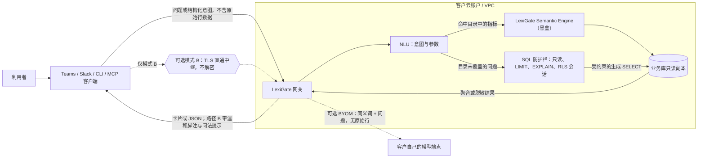

# LexiGate Core

**LexiGate** 是连接 Microsoft Teams（及其他聊天前端）与 AWS 业务数据库（RDS / Aurora，PostgreSQL 与 MySQL）的语义网关。人们用日常语言提问，回答来自受治理的语义层，而不是对生产库结构的无约束闲聊。

本仓库是 **Open-Core 的公开部分**，采用 [Apache License 2.0](LICENSE)。内容是公开契约：`semantic_map` 规范、架构与安全文档、虚构演示数据，以及（即将提供的）结构扫描工具和本地命令行演示。

企业能力——Microsoft Entra ID 行/列级权限、合规审计导出、出站隧道、管理后台、多库路由和生产级连接器——放在**私有**仓库 `lexigate-ee`，不会出现在这里。

> **当前状态（2026 年 11 月）：** 本次发布是文档、v0 规范、虚构的月结演示数据，以及本地 MCP 服务器的骨架。扫描命令行、`docker compose` 演示、`lexigate ask` 和可用的 MCP 服务器**属于 Phase 1 计划，本修订中尚未实现**。现在克隆本仓库还不能得到可运行的产品。

[English README](README.md) · [日本語 README](README.ja.md)

## Open-Core 模型

| 公开（`lexigate-core`，Apache 2.0） | 私有（`lexigate-ee`，商业闭源） |
|---|---|
| `semantic_map.yaml` 规范与 JSON Schema | Excel《テーブル定義書》解析、查询日志挖矿、罗马音增强 |
| 结构扫描 CLI（*Phase 1*） | Entra ID 行/列级权限映射 |
| 本地 Docker Compose + `lexigate ask` 演示（*Phase 1*） | 高级 SQL 防护栏、审计导出到 S3 / SIEM |
| 插件接口（`AuthProvider`、`SchemaEnricher`、`SQLGuardrail`、`AuditLogger`、`TunnelAdapter`）（*Phase 1*） | 出站隧道客户端、CloudFormation 高可用、多库路由 |
| MCP 工具契约 + 只连本地演示库的示例服务器（*Phase 1*） | 管理后台、稟議审批、ROI 报告 |
| 虚构月结示例数据集（本修订已包含） | 离线签名许可（不必依赖中继心跳） |

核心按库来设计，用 `entry_points` 做插件注册。企业版依赖已发布的 core 版本并注入插件。core 里不会出现 `if is_enterprise`。

## 架构

原始业务行数据留在**客户 VPC** 内。网关只返回聚合或脱敏后的结果。若使用大模型，运行在**客户自己的云账户**中（自带模型）。默认网络模式是 **模式 A**：客户自托管端点，不经过 LexiGate 运营的中继。模式 B（仅出站的 TLS 直通中继）为可选项，不解密流量。

**LexiGate Semantic Engine**（指标定义、日语业务同义词、罗马音词典、提示词逻辑）在公开架构里是一个黑盒。本仓库公开的是契约（`semantic_map`），不是这些内部实现。

完整说明见 [docs/architecture.md](docs/architecture.md) 与 [docs/security.md](docs/security.md)，包括六层防护原则和两种部署模式。

## 双路径回答

LexiGate 用两种方式回答问题：

1. **语义层固定查询（优先）。** 常见、高价值的问题（例如「先月末時点の承認済み未払い出張精算は？」）绑定到 `semantic_map.yaml` 中的指标，以固定的参数化查询执行。这类回答又快又稳。
2. **模型生成 SQL（兜底）。** 目录未覆盖的问题，才由模型生成一条 `SELECT`。执行前必须通过只读校验、强制 `LIMIT`、`EXPLAIN` 成本检查，以及该请求的 RLS 会话上下文，并且只能访问语义图中 `sql_guard` 允许的关系。

**回答的展示方式**

- 路径 2 的回答在底部以红色小字温和提示，例如：「※ AI が作成した回答です。念のため内容をご確認ください」／「AI 生成，请留意核对」。
- SQL 原文和口径说明**默认不展示**，只有用户追问时才出现。
- 每条回答都附 1–2 条**问法提示**，引导用户用可以走固定查询的问法再问一次。
- 路径 2 的回答会多一条提示：「確認：さっきの SQL と根拠は？」／「刚才的 SQL 和依据是什么？」。点选后展示该次所用的 SQL 与口径。固定查询的回答不带这条提示。

## 规范与示例

- [`spec/semantic_map.md`](spec/semantic_map.md) — 语义图 v0（意图、指标、关系、权限、证据、`sql_guard`）。
- [`spec/semantic_map.schema.json`](spec/semantic_map.schema.json) — 同一文档的 JSON Schema（YAML 或 JSON）。
- [`spec/mcp.md`](spec/mcp.md) — MCP 工具契约（`resolve_intent`、`query_metric`、`get_evidence` 等）。
- [`examples/monthend/`](examples/monthend/) — 虚构的日本月结数据集与示例 `semantic_map.yaml`。其中的人物和公司均为虚构。
- [`examples/mcp-server/`](examples/mcp-server/) — MCP 服务器**骨架**，会声明工具，并明确说明查询执行尚未实现。

## 路线图

| 阶段 | 内容 | 本修订中的状态 |
|---|---|---|
| 0 | 组织简介、架构文档、`semantic_map` v0、虚构演示数据 | **已发布于本仓库** |
| 1 | `lexigate scan`（PostgreSQL 元数据 → 草稿图）、Docker Compose + `lexigate ask`、插件接口、只连演示库的本地 MCP 服务器 | **即将开始，本修订尚未包含** |
| 2+ | 按真实需求在 `lexigate-ee` 中实现企业插件（Entra、模式 B 隧道、管理后台、MySQL 扫描等） | 私有，不开源排期 |

## 许可、商标与贡献

- 本仓库的源码与文档：[Apache License 2.0](LICENSE)。
- 名称 **LexiGate** 是商标，见 [TRADEMARKS.md](TRADEMARKS.md)。
- 贡献需签署 DCO（`git commit -s`），见 [CONTRIBUTING.md](CONTRIBUTING.md)。暂不要求 CLA。
- 漏洞请私下报告：[SECURITY.md](SECURITY.md)。

组织主页：[github.com/lexigate](https://github.com/lexigate)
