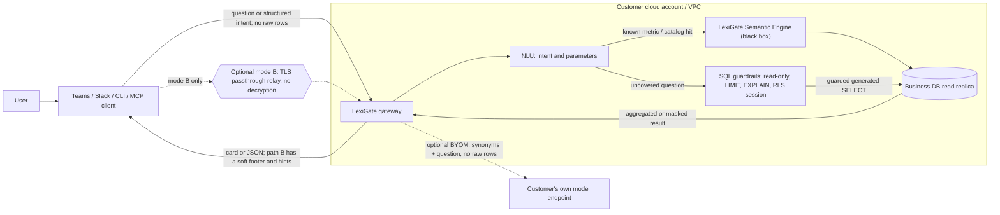

# LexiGate architecture

This document is the public architecture. It describes how data moves, how questions are answered, and what is intentionally left as a black box. Implementation source for the engine, enterprise plug-ins, and the month-end demo application is not in this repository.

Related: [security.md](security.md), the [`semantic_map` specification](../spec/semantic_map.md), the [MCP contract](../spec/mcp.md).

## Goals

- Let business users ask in everyday Japanese (and later other languages) about metrics they are allowed to see.
- Keep **raw business rows inside the customer VPC**. Only aggregated or masked results leave the database path.
- Make the semantic contract (`semantic_map.yaml`) inspectable, versioned, and exportable, so customers are not locked into a hidden metric language.
- Prefer answers that come from **reviewed, fixed queries**. Allow a model to generate SQL only when the catalog does not cover the question, and only behind guardrails.

## Context

### What stays a black box

The public diagram groups the following into **LexiGate Semantic Engine**:

- How a Japanese business term (including romaji abbreviations on a messy legacy schema) is bound to a metric.
- Multi-step prompt logic used to reduce hallucinated questions or SQL.
- The internal implementation of complex, reviewed metric SQL.

What is *not* hidden: the `semantic_map` document a customer can read, diff, and export; the guardrail rules; the data-flow and trust boundaries; and the MCP tool shapes.

## Dual-path answering

Every question is classified as path 1 or path 2.

### Path 1 — fixed semantic query (preferred)

The question maps to an intent and parameters declared in `semantic_map.yaml` (for example `unpaid_summary` + `as_of: previous_month_end`). The engine runs a **fixed, parameterized** query already bound to that metric. No SQL is generated for that request.

These answers are the ones you want for month-end close and other high-stakes numbers: they are stable, auditable, and fast.

### Path 2 — model-generated SQL (fallback)

Only if the catalog does not cover the question may a model draft a single `SELECT`. Before execution the statement must pass:

- read-only validation (one `SELECT`, no writes, no multiple statements);
- a mandatory `LIMIT`;
- an `EXPLAIN` cost / row-estimate check;
- the request’s **RLS session context** (identity is applied as session state, not as a string the model is trusted to embed);
- the allow / deny lists in `sql_guard` (allowed relations and functions only).

If any check fails, the gateway does not run the statement. It should ask a clarifying question or refuse.

### How answers are shown

| | Path 1 (fixed query) | Path 2 (generated SQL) |
|---|---|---|
| Result body | The metric result | The metric result |
| Footer | No AI disclaimer | Soft red note, small type: 「※ AI が作成した回答です。念のため内容をご確認ください」 / “AI-generated — please double-check.” |
| SQL and rationale | Not attached | Hidden until the user asks |
| Suggested follow-ups | 1–2 prompts that can be served by a fixed query | The same, **plus** 「確認：さっきの SQL と根拠は？」 / “Show me the SQL and the rationale.” |

The extra path-2 suggestion, if chosen, reveals the SQL that was executed and the metric / rule text used as grounds. Path 1 answers do not offer this control, because no SQL was generated.

Suggested follow-ups are a product feature, not a substitute for the catalog. Their job is to nudge the next question onto path 1.

## Deployment modes

**Mode A (default): customer-hosted endpoint.** The Teams / Bot / MCP client calls an endpoint the customer operates inside their account (typically behind a load balancer that allows Microsoft Bot traffic). LexiGate does not touch the data plane. This is the mode Japanese information-security teams usually prefer, because there is no operator-side relay and no extra processor of personal data.

**Mode B (optional): outbound-only tunnel.** If the customer cannot accept an inbound port, the gateway initiates an outbound TLS connection. A relay, if used, is **TLS passthrough and must not decrypt**. Mode B is not a license-enforcement mechanism. Licensing for the enterprise edition is an **offline signed file**; a running system must not have to phone home.

Large language models are **bring your own model** (for example Amazon Bedrock or Azure OpenAI in the customer account, in-region). LexiGate does not take a cut of token spend and should not send raw row data to the model. Prompts may include synonyms, catalog excerpts, and the question.

## Plugin-shaped core (Phase 1)

The intended library boundaries (Phase 1). In 0.1 only two pieces exist as code: the scanner (`lexigate.scanner`, the core default behind `SchemaEnricher`) and the catalog-driven rules NLU (`lexigate.nlu.RulesNLU`). The answer engine also exposes an `AnswerPath` extension point (entry-point group `lexigate.answer_paths`) for the future path 2. The interfaces in the table are not yet published as stable APIs:

| Interface | Core default | Enterprise plug-in (private) |
|---|---|---|
| `AuthProvider` | Resolve a local / demo identity; set a database session context | Entra ID → principal, RLS / CLS |
| `SchemaEnricher` | `information_schema` scan into a draft `semantic_map` | Excel definition books, query-log mining, romaji |
| `SQLGuardrail` | Read-only, `LIMIT`, `EXPLAIN`, `sql_guard` allow lists | AST cost fuse, concurrency limits |
| `AuditLogger` | Local structured log | Export to S3 / CloudWatch / SIEM |
| `TunnelAdapter` | No-op (Mode A) | Outbound tunnel client |
| `NluProvider` | Catalog-driven rules (and, later, an optional BYOM implementation) | Vendor-specific prompt packs, if any |

Enterprise code depends on core; core never depends on enterprise. Plug-ins are discovered with Python `entry_points`. There is no `if is_enterprise` in core.

## What this repository does *not* contain

- A runnable gateway, Teams bot, Slack adapter, or Copilot package.
- Database RLS policies, production SQL functions, or NLU prompt chains.
- A working MCP server (skeleton only), model-generated SQL (path 2), or the plugin interfaces below.

Since 0.1 the repository does contain `lexigate scan`, a demo-only ask service with fixed queries and rules-based NLU, and demo semantic functions (schema `sem`, no RLS) for the fictional dataset. See the README Quickstart.

Those items are either Phase 1 work in this repository or private enterprise / demo work. Please treat anything that looks like a complete product in this revision as a documentation error and file an issue.
